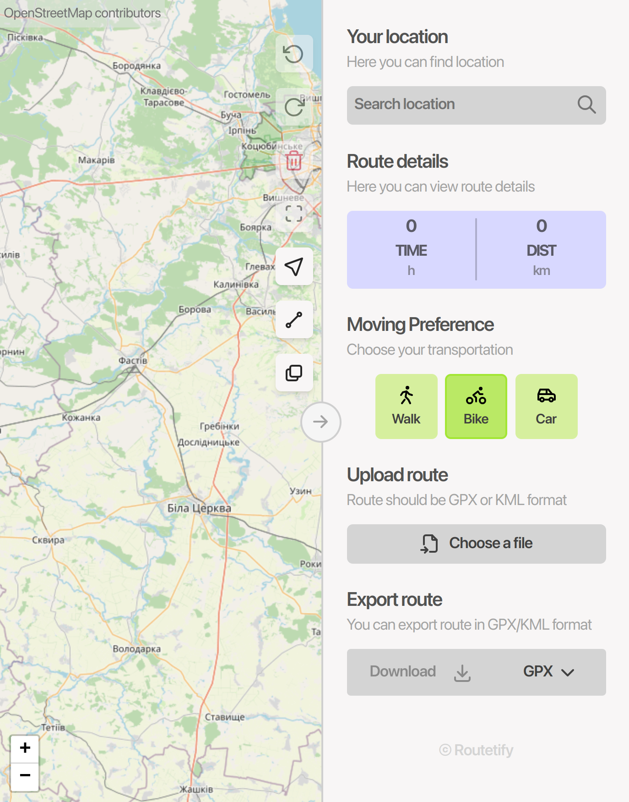

# routetify

A map-based route editor: draw a route on the map, then export it as GPX or KML, or import an existing GPX/KML file to keep editing it.



## Features

- Draw routes on an interactive Leaflet map
- Export routes to **GPX** and **KML**
- Import GPX/KML files by drag and drop
- Location search to start a route anywhere
- Keyboard shortcuts and light/dark theme

## Stack

Next.js 13 (App Router) · React · TypeScript · Redux Toolkit · Leaflet / react-leaflet · Tailwind CSS · Radix UI · Zod

## Running locally

```bash
yarn install
yarn dev          # http://localhost:3000
```

Or with Docker: `docker compose up`.
